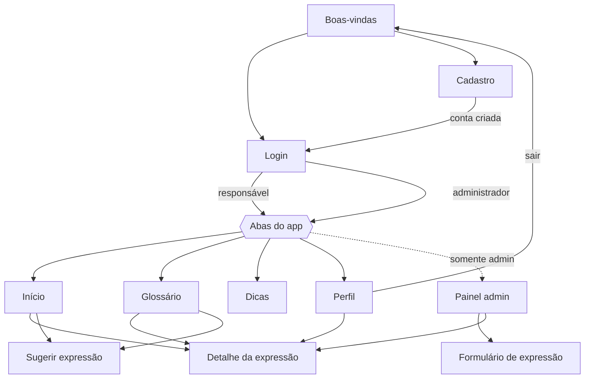

# Conexão Pais — App

> **ajudando a unir famílias e gerações**

Versão mobile da plataforma **Conexão Pais**: um aplicativo educativo que ajuda pais, mães, responsáveis e
educadores a entender gírias, memes, abreviações, tendências e comportamentos digitais usados por crianças e
adolescentes, e transforma cada expressão em um ponto de partida para conversar.

Projeto avaliativo da disciplina de Aplicações Mobile (React Native + API REST + MySQL + JWT), desenvolvido em
4 entregas incrementais.

| Entrega | Conteúdo | Situação |
| --- | --- | --- |
| **1** | Problema, proposta, projeto Expo, telas, navegação e repositório | ✅ Entregue |
| 2 | Modelagem, MySQL, API Express, integração com `fetch()` | ⏳ Próxima etapa |
| 3 | Cadastro, login, hash de senha, JWT, níveis de usuário e CRUD completo | ⏳ |
| 4 | Testes, correções, README final, APK e apresentação | ⏳ |

---

## 1. Proposta do projeto (Entrega 1)

### 1.1 Problema atual identificado

A linguagem das novas gerações muda muito rápido. Gírias, memes, abreviações e tendências surgem nas redes
sociais, nos jogos e nos vídeos curtos e são substituídas em poucos meses. Muitos pais e responsáveis não
conseguem acompanhar esse ritmo e **não entendem o que crianças e adolescentes estão dizendo**. Isso gera
ruído nas conversas em família e dificulta a mediação do uso da tecnologia.

O problema não é falta de interesse dos adultos. Falta a eles **acesso rápido, confiável e contextualizado**
a esse conhecimento: a informação existe, mas está espalhada pela internet, sem explicação do contexto e sem
orientação sobre como transformar a dúvida em diálogo.

> **Pergunta orientadora:** como uma aplicação mobile pode reduzir a barreira de comunicação causada pela
> transformação constante da linguagem e da cultura digital entre pais e filhos?

### 1.2 Contexto e público afetado

- **Público principal:** pais, mães, avós, responsáveis e outros adultos que convivem com crianças e
  adolescentes.
- **Público secundário:** educadores e comunidade escolar, que também precisam se comunicar com os jovens e
  orientá-los.
- **Afetados indiretamente:** crianças e adolescentes, que ganham adultos mais preparados para ouvir,
  conversar e orientar sem julgamento.

O contexto é o de famílias em que o celular e as redes sociais fazem parte da rotina dos jovens, enquanto os
adultos têm pouco tempo e pouca familiaridade com esse universo.

### 1.3 Justificativa

- **A velocidade da mudança:** uma expressão popular hoje pode desaparecer em poucos meses. Por isso, o
  conteúdo precisa ser atualizado continuamente e de forma colaborativa.
- **Mediação parental:** para orientar os jovens no ambiente digital, os adultos precisam conhecer
  minimamente os espaços, as linguagens e as referências que fazem parte da realidade deles.
- **Letramento digital e educação não formal:** a aprendizagem não precisa acontecer só na escola. O app
  funciona como um recurso de consulta e aprendizagem ao longo da vida, alinhado ao **ODS 4 (Educação de
  Qualidade)** da Agenda 2030 da ONU.
- **Por que um app (e não só o site):** a dúvida aparece no meio da conversa, e o celular é o dispositivo que
  o adulto tem à mão nesse momento. O app permite consulta rápida, favoritos e, futuramente, avisos sobre
  novas expressões.
- **Aprendizagem mútua:** a proposta não coloca o adulto como quem "fiscaliza". Ela incentiva a curiosidade e
  a troca entre gerações, em que o jovem também ensina.

### 1.4 Proposta de solução

O **Conexão Pais** é um aplicativo com:

1. **Glossário de expressões** organizado por categoria (gíria, meme, abreviação, tendência e comportamento
   digital), com significado, exemplo de uso, origem e uma **dica de como conversar** sobre o assunto.
2. **Dicas de conversa**: conteúdos curtos sobre diálogo, escuta ativa, mediação digital e bem-estar.
3. **Colaboração moderada**: o responsável pode **sugerir** uma expressão que ouviu e não encontrou. Um
   **administrador** revisa, completa e publica, o que garante a qualidade do conteúdo.
4. **Área administrativa** para manter o glossário atualizado (CRUD das expressões) e moderar as sugestões.

A **entidade principal** do sistema é a **Expressão** (termo do glossário). É ela que terá CRUD completo
integrado à API e ao banco de dados nas próximas entregas.

### 1.5 Nome da aplicação

**Conexão Pais**, com o slogan *"ajudando a unir famílias e gerações"*, o mesmo nome do projeto de pesquisa
e da versão web.

### 1.6 Tipos de usuário

| Tipo | Quem é | Objetivo no app |
| --- | --- | --- |
| **Visitante** | Pessoa ainda não autenticada | Conhecer o app, criar conta e fazer login |
| **Responsável** (`responsavel`) | Pai, mãe, avó/avô, responsável ou educador cadastrado | Consultar o glossário, ler dicas, favoritar e sugerir expressões |
| **Administrador** (`admin`) | Equipe do projeto (curadoria do conteúdo) | Manter o glossário, moderar sugestões e gerenciar usuários |

Os dois **níveis de usuário** autenticados são `responsavel` e `admin`. O visitante representa o estado
"não logado".

### 1.7 Permissões iniciais

| Ação | Visitante | Responsável | Administrador |
| --- | :---: | :---: | :---: |
| Ver tela de boas-vindas, login e cadastro | ✅ | — | — |
| Criar conta | ✅ | — | — |
| Consultar o glossário e o detalhe das expressões | ❌ | ✅ | ✅ |
| Buscar e filtrar expressões por categoria | ❌ | ✅ | ✅ |
| Ler dicas de conversa | ❌ | ✅ | ✅ |
| Favoritar expressões | ❌ | ✅ | ✅ |
| Sugerir nova expressão e acompanhar o status | ❌ | ✅ | ✅ |
| Ver e editar o próprio perfil / sair | ❌ | ✅ | ✅ |
| **Cadastrar, editar e excluir expressões (CRUD)** | ❌ | ❌ | ✅ |
| **Aprovar ou recusar sugestões** | ❌ | ❌ | ✅ |
| **Gerenciar usuários (alterar nível)** | ❌ | ❌ | ✅ |

Na Entrega 3 essas permissões serão garantidas **no back-end** por middleware de autenticação (JWT enviado
como Bearer Token) e de autorização por nível.

### 1.8 Principais funcionalidades

1. Cadastro e login de usuários (senha com hash e JWT, na Entrega 3).
2. Glossário com **busca** por termo e **filtro por categoria**.
3. Detalhe da expressão: significado, exemplo, origem e dica de conversa.
4. **Expressão em destaque** na tela inicial.
5. Dicas de conversa entre gerações.
6. Favoritos do usuário.
7. Sugestão de novas expressões pelos responsáveis.
8. Painel do administrador: CRUD de expressões e moderação de sugestões.
9. Perfil com dados do usuário, favoritos, sugestões enviadas e logout.

### 1.9 Telas previstas

| # | Tela | Acesso | Descrição |
| --- | --- | --- | --- |
| 1 | Boas-vindas | Visitante | Apresentação do app e acesso ao login/cadastro |
| 2 | Login | Visitante | E-mail e senha |
| 3 | Cadastro | Visitante | Nome, e-mail, perfil (pai/mãe, avó/avô…) e senha |
| 4 | Início | Responsável e admin | Saudação, expressão em destaque, categorias e dica do dia |
| 5 | Glossário | Responsável e admin | Lista com busca e filtro por categoria |
| 6 | Detalhe da expressão | Responsável e admin | Significado, exemplo, origem, dica e favoritar |
| 7 | Dicas de conversa | Responsável e admin | Conteúdos educativos sobre diálogo |
| 8 | Sugerir expressão | Responsável e admin | Formulário de sugestão |
| 9 | Perfil | Responsável e admin | Dados, favoritos, sugestões e logout |
| 10 | Painel administrativo | Somente admin | Lista de expressões (editar/excluir) e moderação de sugestões |
| 11 | Formulário de expressão | Somente admin | Criar ou editar uma expressão |

### 1.10 Fluxo inicial de navegação

**Organização da navegação (React Navigation):**

- **Stack raiz** (`native-stack`): mostra as telas públicas (Boas-vindas, Login, Cadastro) quando não há
  usuário logado e as telas autenticadas quando há.
- **Abas inferiores** (`bottom-tabs`): Início, Glossário, Dicas e Perfil, mais a aba **Admin** que só aparece
  para administradores.
- **Telas empilhadas sobre as abas:** Detalhe da expressão, Sugerir expressão e Formulário de expressão
  (somente admin).

---

## Autoria

Desenvolvido por **Ana Elisa Sprenger** ([@anasprenger](https://github.com/anasprenger)).
