# Conexão Pais — App

> **Ajudando a unir famílias e gerações.**

Versão mobile do portal **Conexão Pais** ([conexaopais.com](https://conexaopais.com)): artigos, colunas, revista
digital, profissionais parceiros e comunidade para quem cuida, educa e acompanha crianças e adolescentes.

Projeto avaliativo da disciplina de Aplicações Mobile (React Native + API REST + banco de dados + JWT), desenvolvido
em 4 entregas incrementais. **O app usa o mesmo banco de dados e as mesmas contas do site** (seção "Integração com o
banco do site", logo abaixo).

| Entrega | Conteúdo | Situação |
| --- | --- | --- |
| **1** | Problema, proposta, projeto Expo, telas, navegação e repositório | ✅ Entregue |
| **2** | Modelagem, MySQL, API Express, integração com `fetch()` | ✅ Entregue |
| **3** | JWT, Bearer Token, middleware, níveis no back-end, rotas protegidas e logout | ✅ Concluída |
| **4** | Testes, correções, README final, APK e apresentação | 🔧 APK gerado ([baixar](https://expo.dev/accounts/anasprenger/projects/conexao-pais/builds/fc657781-6d4f-4db7-8096-564304ab2395)); falta testar no celular (seção 4) |
| **+** | Integração com o banco do site (Supabase), autorizada pelo professor | ✅ Branch `integracao-supabase` |

---

## Integração com o banco do site

O PDF da disciplina pede MySQL. Com **autorização do professor**, o app passou a usar o **banco do site Conexão Pais**
(PostgreSQL no Supabase) no lugar de um MySQL separado. Assim, site e app são um produto só:

- **as mesmas contas**: quem tem conta no site entra no app com o mesmo e-mail e senha, e vice-versa;
- **os mesmos níveis**: `usuario` (família), `profissional` (com verificação da administração) e `admin`, guardados
  na tabela `user_roles` do site;
- **as mesmas publicações**: um artigo publicado no app aparece no site, e o contrário também; curtidas, salvos e
  comentários são compartilhados;
- **a mesma moderação**: aprovar um profissional no app vale no site; um artigo de exemplo escondido no app some do site.

**O que não mudou** (requisitos do PDF): o app continua falando só com a **API REST em Node.js + Express**, com
`fetch()`; a API continua **gerando o próprio JWT**, que o app envia como **Bearer Token**; os **middlewares** da API
continuam conferindo o token e o nível em cada rota protegida; o CRUD da entidade principal (`publicacoes`) continua
na API.

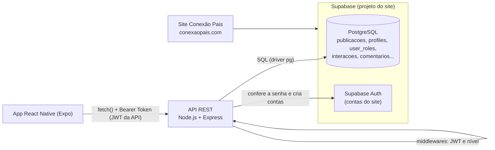

| Antes (Entregas 2 a 4) | Agora |
| --- | --- |
| MySQL no notebook, só do app | PostgreSQL do Supabase, o mesmo do site |
| Tabela `usuarios` com `senha_hash` (bcrypt feito pela API) | Contas no Supabase Auth (`auth.users`, hash bcrypt), perfil em `profiles` e níveis em `user_roles` |
| Ids numéricos; artigo em `/artigos/:id` | Ids UUID; artigo identificado pelo **slug**, como no site (`/artigos/:slug`) |
| Colunas, revista e profissionais em tabelas próprias | Iguais ao site: exemplos do site + o que a administração publica no banco |
| Login: a API comparava a senha com `bcrypt.compare` | Login: o Supabase Auth confere a senha; a API lê o nível e **gera o JWT dela** |
| Testes usavam o MySQL do `.env` | Testes usam um PostgreSQL em memória com as migrations do site (não tocam no banco real) |

A versão com MySQL (Entregas 2 a 4) continua no histórico do Git, no commit `72e0a4f`.

## 1. Proposta do projeto (Entrega 1)

### 1.1 Problema atual identificado

Quem cuida de crianças e adolescentes tem dúvidas todos os dias: desenvolvimento, sono, escola, telas, limites,
convivência com os avós. Informação existe de sobra, mas está **espalhada, nem sempre é confiável** e muitas vezes
vem cheia de jargão ou de julgamento. Na prática, quem cuida costuma **se sentir sozinho ao decidir**.

> *"Cuidar dá trabalho. Encontrar boa informação não deveria dar."*

> **Pergunta orientadora:** como uma aplicação mobile pode reunir informação confiável, acolhimento e contato com
> profissionais em um só lugar para quem cuida?

### 1.2 Contexto e público afetado

- **Público principal:** pais, mães, avós e outros responsáveis, em todas as configurações de família.
- **Profissionais parceiros:** psicólogos, pediatras, pedagogos, terapeutas familiares e outras pessoas que
  atendem famílias e querem publicar conteúdo de qualidade.
- **Afetados indiretamente:** crianças e adolescentes, que ganham adultos mais bem informados e mais tranquilos
  para conversar.

O projeto já existe como portal web (site Conexão Pais). O app leva esse ecossistema para o celular, que é onde a
dúvida aparece: no carro, na fila da escola, na hora de dormir.

### 1.3 Justificativa

- **Credibilidade:** o conteúdo é escrito e revisado por profissionais, com autoria visível.
- **Acolhimento:** linguagem clara, sem jargão e sem julgamento, pensada para diferentes arranjos familiares.
- **Rede de apoio:** a comunidade (curtir, salvar, comentar, perguntar à equipe) e o diretório de profissionais
  verificados mostram que ninguém precisa cuidar sozinho.
- **Segurança:** só profissionais com registro conferido pela administração podem publicar.
- **Por que um app:** consulta rápida no momento da dúvida, conteúdos salvos sempre à mão e, futuramente, avisos
  de novas colunas e edições da revista.
- **ODS 4 (Educação de Qualidade):** educação não formal e aprendizagem ao longo da vida para famílias.

### 1.4 Proposta de solução

O **app Conexão Pais** reúne, no celular, as seções do portal:

1. **Conteúdos:** artigos, colunas assinadas e a revista digital (leitura página a página).
2. **Profissionais:** diretório com especialidade, cidade, forma de atendimento e contato por WhatsApp.
3. **Comunidade:** curtidas, conteúdos salvos, comentários nos artigos, perguntas à equipe e regras de convivência.
4. **Área de publicação:** profissionais aprovados e a administração publicam, editam e excluem artigos.
5. **Administração:** verificação de novos profissionais (aprovar ou recusar) e moderação.

A **entidade principal** é a **Publicação (artigo)**, com CRUD completo integrado à API e ao banco: é a tabela
`publicacoes` do site.

**Arquitetura da solução** (construída ao longo das 4 entregas):

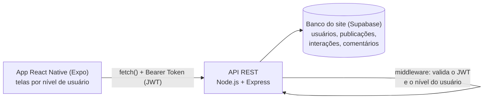

Situação atual: telas, navegação e regras de acesso por nível (Entrega 1); API Express e banco integrados ao app
com `fetch()` (Entrega 2); login com JWT, Bearer Token e rotas protegidas por nível no back-end (Entrega 3); banco
e contas compartilhados com o site (integração com o Supabase).

### 1.5 Nome da aplicação

**Conexão Pais**, o mesmo nome do portal, com o slogan *"Ajudando a unir famílias e gerações."*

### 1.6 Tipos de usuário

Os níveis são os mesmos do site (`app_role`):

| Tipo | Nível | Quem é |
| --- | --- | --- |
| **Visitante** | — | Pessoa sem conta ou que ainda não entrou: lê os conteúdos e vê os profissionais |
| **Família** | `usuario` | Pai, mãe, avó/avô ou outro responsável |
| **Profissional** | `profissional` | Profissional parceiro. Começa **em verificação** e só publica depois de **aprovado** pela administração |
| **Administração** | `admin` | Equipe do Conexão Pais (curadoria, moderação e verificação) |

Situações do cadastro profissional: `pendente` → `aprovado` ou `recusado` (as mesmas do painel do site).

### 1.7 Permissões iniciais

| Ação | Visitante | Família | Profissional em verificação | Profissional aprovado | Admin |
| --- | :---: | :---: | :---: | :---: | :---: |
| Ver boas-vindas, entrar e criar conta | ✅ | — | — | — | — |
| Ler artigos, colunas e revista | ✅ | ✅ | ✅ | ✅ | ✅ |
| Ver profissionais e chamar no WhatsApp | ✅ | ✅ | ✅ | ✅ | ✅ |
| Enviar mensagem de contato | ✅ | ✅ | ✅ | ✅ | ✅ |
| Curtir, salvar e comentar | ❌ | ✅ | ✅ | ✅ | ✅ |
| Excluir o próprio comentário | ❌ | ✅ | ✅ | ✅ | ✅ |
| Publicar artigo | ❌ | ❌ | ❌ | ✅ | ✅ |
| Editar e excluir artigo | ❌ | ❌ | ❌ | só os próprios | todos |
| Excluir comentário de outra pessoa | ❌ | ❌ | ❌ | ❌ | ✅ |
| Aprovar ou recusar profissionais | ❌ | ❌ | ❌ | ❌ | ✅ |

**Mudança na Entrega 2:** a leitura passou a ser aberta a visitantes, como no site. A conta é pedida só para
interagir: ao tocar em Curtir ou Salvar sem conta, o app oferece Entrar; os campos de comentário e de pergunta dão
lugar a um convite para entrar ou criar conta. Depois do login, a pessoa volta para a tela onde estava.

São as mesmas regras do banco do site (políticas da tabela `publicacoes`: *"Admin e profissional aprovado
criam"*, *"Autor ou admin edita"*, *"Autor ou admin remove"*). Desde a Entrega 3 elas são garantidas **no back-end**
por middlewares de autenticação (JWT enviado como Bearer Token) e de autorização por nível (seção 3).

### 1.8 Principais funcionalidades

1. Cadastro com tipo de conta (família ou profissional, com profissão e número de registro) e login.
2. Início com destaques: artigo em destaque, revista atual, profissionais, colunas e "Como funciona".
3. Artigos com busca e filtro por categoria; leitura com curtir, salvar e comentários.
4. Colunas assinadas e revista digital com leitor página a página.
5. Diretório de profissionais com busca, filtro por especialidade e contato por WhatsApp.
6. Comunidade: conversas em andamento, destaques (mais curtidos e mais salvos), pergunta à equipe e regras.
7. Minha conta: dados e nível do usuário, situação do cadastro profissional, conteúdos salvos e logout.
8. Área de publicação: criar, editar e excluir artigos, conforme o nível.
9. Administração: verificação de novos profissionais.
10. Sobre (valores, história e equipe) e Contato.

### 1.9 Telas previstas

Todas as telas abaixo existem no app. A seção 2.2 mostra quais rotas da API cada uma usa.

| # | Tela | Acesso | Descrição |
| --- | --- | --- | --- |
| 1 | Boas-vindas | Visitante | Apresentação, foto da família, Entrar / Criar conta e Explorar sem conta |
| 2 | Entrar | Visitante | E-mail e senha (+ perfis de demonstração) |
| 3 | Criar conta | Visitante | Nome, e-mail, tipo de conta, profissão/registro (profissional) e senha |
| 4 | Início | Todos | Saudação, destaques e atalhos |
| 5 | Conteúdos | Todos | Artigos (busca e categorias), Colunas e Revista |
| 6 | Artigo | Todos | Leitura, curtir, salvar, comentários e conteúdos relacionados |
| 7 | Coluna | Todos | Apresentação da coluna e publicações |
| 8 | Revista (sinopse) | Todos | Capa, sinopse, "Nesta edição", Começar a leitura e Baixar PDF (como "Conheça esta edição" no site). Admin: Editar edição |
| 8.1 | Modo de leitura | Todos | Tela cheia no formato de story, como o site no celular: toque à direita avança, à esquerda volta e no meio mostra o progresso e o botão de sair |
| 9 | Profissionais | Todos | Diretório com busca e filtro por especialidade |
| 10 | Perfil profissional | Todos | Dados, contato por WhatsApp, conteúdos e colunas |
| 11 | Comunidade | Todos | Recursos, conversas, destaques, pergunta à equipe e regras |
| 12 | Minha conta | Todos | Logado: perfil, nível, salvos, publicações, administração e excluir a própria conta (digitando EXCLUIR). Visitante: Entrar / Criar conta |
| 13 | Sobre | Todos | Valores, como surgiu e equipe |
| 14 | Contato | Todos | Formulário de mensagem para a equipe |
| 15 | Nova postagem / Editar artigo | Profissional aprovado e admin | Formulário do artigo |
| 16 | Novos profissionais | Somente admin | Aprovar ou recusar cadastros |
| 16.1 | Usuários | Somente admin | Todas as contas, com busca e filtros; muda o tipo de conta (administração e profissional), suspende ou reativa e exclui, como a página "Usuários" do site |
| 16.2 | Editar edição | Somente admin | Título e sinopse das edições publicadas pelo site (o PDF é trocado pelo site) |
| 17 | Conexão com a API | Todos | Endereço da API usado pelo app (testa antes de salvar). Incluída na Entrega 4, para o APK |

### 1.10 Fluxo inicial de navegação

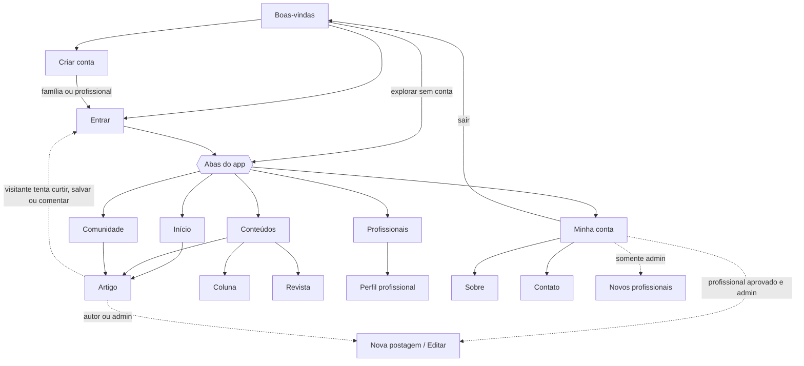

**Como a navegação está organizada (React Navigation):**

- **Stack raiz** (`native-stack`): as abas e as telas de leitura ficam disponíveis para todos. Boas-vindas, Entrar
  e Criar conta existem só para quem não entrou; **conforme o nível**, entram a área de publicação (`canPublish`)
  e a verificação de profissionais (`isAdmin`). Uma tela que não foi registrada não pode ser aberta.
- **Abas inferiores** (`bottom-tabs`): Início, Conteúdos, Profissionais, Comunidade e Minha conta.
- **Telas empilhadas sobre as abas:** Artigo, Coluna, Revista, Perfil profissional, Sobre, Contato, Nova postagem e
  Novos profissionais.

---

## 2. Planejamento técnico e integração (Entrega 2)

### 2.1 Requisitos funcionais atualizados

| # | Requisito | Situação |
| --- | --- | --- |
| RF01 | Criar conta de família ou profissional (profissão e registro), com senha salva em hash | ✅ API + banco |
| RF02 | Entrar com e-mail e senha conferidos pela API | ✅ API + banco · devolve um JWT (Entrega 3) |
| RF03 | Sair da conta | ✅ apaga o token do aparelho (Entrega 3) |
| RF04 | Listar artigos e buscar por termo e categoria | ✅ API + banco |
| RF05 | Ler o artigo completo | ✅ API + banco |
| RF06 | Publicar artigo (só profissional aprovado ou admin) | ✅ middleware `exigirPublicador` (Entrega 3) |
| RF07 | Editar e excluir artigo (autor ou admin) | ✅ middleware `autorDoArtigoOuAdmin` (Entrega 3) |
| RF08 | Curtir e salvar artigos; ver os salvos em Minha conta | ✅ API + banco |
| RF09 | Comentar e excluir o próprio comentário | ✅ API + banco · autor ou admin exclui (Entrega 3) |
| RF10 | Ver colunas e suas publicações | ✅ API + banco |
| RF11 | Ler a revista digital página a página | ✅ API + banco |
| RF12 | Buscar profissionais e ver o perfil com artigos e colunas | ✅ API + banco |
| RF13 | Enviar mensagem de contato e pergunta à equipe | ✅ API + banco |
| RF14 | Aprovar ou recusar cadastros profissionais (admin), como no painel do site | ✅ API + banco · só admin (Entrega 3) |
| RF15 | Proteger as rotas com token JWT e nível de usuário | ✅ Entrega 3 (seção 3) |
| RF16 | Ler conteúdos sem conta; para interagir, o app pede login e volta para a mesma tela depois | ✅ |
| RF17 | Continuar logado ao reabrir o app e sair sozinho quando o token vence, com aviso | ✅ Entrega 3 |

**Requisitos não funcionais já atendidos:** senha nunca é salva em texto (hash bcrypt, guardado pelo Supabase Auth);
validação dos dados no app **e** na API; consultas SQL com parâmetros (`$1`, `$2`...), que evitam SQL injection; respostas de erro padronizadas
(`{ erro, campos }`) exibidas nas telas; credenciais do banco fora do repositório (`.env`). Na Entrega 3: token
JWT assinado (HS256) e com validade, segredo `JWT_SECRET` fora do repositório, token guardado criptografado no
aparelho e permissões conferidas no back-end em toda requisição protegida.

### 2.2 Telas e fluxos atualizados

As telas e a navegação continuam as da seção 1.10. O que mudou é a origem dos dados: agora tudo vem da API. Desde a
Entrega 3, as requisições de quem entrou levam o token no cabeçalho `Authorization: Bearer <token>`.

| Tela | Rotas da API usadas |
| --- | --- |
| Abertura do app | `GET /api/auth/perfil` (confere o token guardado) |
| Entrar | `POST /api/auth/login` |
| Criar conta | `POST /api/usuarios` |
| Início | `GET /api/artigos`, `GET /api/revistas`, `GET /api/profissionais`, `GET /api/colunas` |
| Conteúdos | `GET /api/artigos?busca=&categoria=`, `GET /api/categorias`, `GET /api/colunas`, `GET /api/revistas` |
| Artigo | `GET /api/artigos/:slug`, `GET` e `POST /api/artigos/:slug/comentarios`, `DELETE /api/comentarios/:id`, `POST /api/artigos/:slug/interacoes`, `DELETE /api/artigos/:slug` |
| Coluna | `GET /api/colunas/:slug`, `POST /api/colunas/:slug/posts/:postSlug/interacoes` (curtir e salvar; sem comentários) |
| Revista (sinopse e leitura) | `GET /api/revistas/:slug` |
| Editar edição | `GET` e `PUT /api/revistas/:slug` |
| Usuários | `GET /api/usuarios`, `PATCH /api/usuarios/:id/papel`, `PATCH /api/usuarios/:id/suspensao`, `DELETE /api/usuarios/:id` |
| Profissionais / Perfil profissional | `GET /api/profissionais`, `GET /api/profissionais/:slug` |
| Comunidade | `GET /api/artigos`, `POST /api/artigos/:slug/interacoes`, `POST /api/mensagens` |
| Minha conta | `GET /api/auth/perfil`, `GET /api/usuarios/:id/interacoes`, `DELETE /api/artigos/:slug`, `DELETE /api/usuarios/:id` (excluir a conta); admin: `GET /api/usuarios?nivel=profissional&verificacao=pendente` |
| Nova postagem / Editar artigo | `POST /api/artigos`, `GET` e `PUT /api/artigos/:slug`, `GET /api/categorias` |
| Novos profissionais | `GET /api/usuarios?nivel=profissional`, `PATCH /api/usuarios/:id/verificacao` |
| Contato | `POST /api/mensagens` |

**Caminho de uma requisição** (exemplo: publicar um artigo):

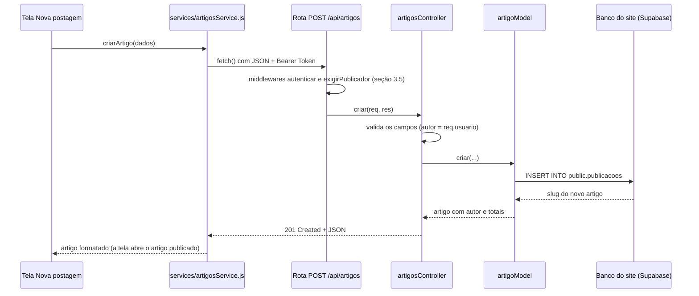

Se algo der errado, a API responde com o status adequado (400, 401, 403, 404, 409, 503) e uma mensagem. A tela mostra
essa mensagem e, nos formulários, o erro aparece embaixo do campo correspondente.

### 2.3 Estrutura do banco de dados

O app usa o **banco do site** (PostgreSQL no Supabase, projeto `conexao-pais`). A estrutura é criada pelas
migrations do site, copiadas em [`database/supabase/migrations/`](database/supabase/migrations) (a fonte oficial
fica no repositório do site). O app não criou tabelas novas: usa as do site, com as mesmas regras.

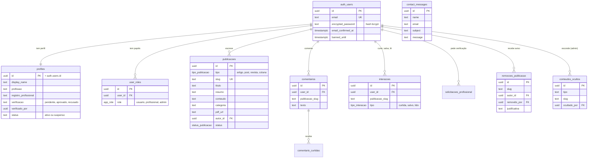

Como a API usa cada parte:

- **Contas e níveis:** `auth.users` (e-mail e hash, cuidados pelo Supabase Auth), `profiles` (nome, profissão,
  verificação) e `user_roles` (papéis). Uma conta pode ter mais de um papel; vale o mais alto
  (admin > profissional > usuario). A API junta as três tabelas em `usuarioModel.js`.
- **`publicacoes` é a entidade principal.** O app cria e edita o tipo `artigo` e lista `artigo` e `post`, como a
  página de artigos do site. Colunas (`coluna`) e edições da revista (`revista`, com PDF no Supabase Storage) são
  publicadas pelo site e aparecem no app.
- **Comentários e interações ficam ligados ao `slug`**, e não ao id. Assim valem também para os conteúdos de exemplo,
  que o site guarda no próprio código (copiados na API em `api/src/data/conteudoSite.js`). Por isso o app identifica
  os artigos pelo slug.
- **`interacoes` tem chave única (usuário + slug + tipo):** ninguém curte ou salva o mesmo artigo duas vezes.
- **Moderação:** `conteudos_ocultos` (exemplos escondidos pela administração) e `remocoes_publicacao` (aviso ao autor
  quando a administração remove a publicação dele).
- **Contato:** `contact_messages`, gravada pela função `submit_contact_message` do site, que valida e limita a
  3 mensagens por hora por e-mail.
- **Gatilhos do site que a API aproveita:** `handle_new_user` (cria perfil e nível no cadastro) e
  `protect_profile_verification_fields` (só admin muda a verificação profissional).

### 2.4 Entidades e campos

| Entidade (tabela) | Campos principais | Relacionamentos |
| --- | --- | --- |
| Conta (`auth.users`) | e-mail (único), hash da senha, confirmação de e-mail, suspensão | tem um perfil e papéis |
| Perfil (`profiles`) | nome, profissão, registro, verificação, quem verificou, situação | um por conta |
| Papel (`user_roles`) | conta, papel (`usuario`, `profissional`, `admin`) | vários por conta |
| **Publicação (`publicacoes`)** | tipo, slug (único), título, resumo, conteúdo, categoria, PDF, autor, status | pertence a uma conta |
| Comentário (`comentarios`) | conta, slug da publicação, texto | pertence a uma conta |
| Interação (`interacoes`) | conta, slug da publicação, tipo (curtida/salvo/lido) | une conta e publicação |
| Mensagem de contato (`contact_messages`) | nome, e-mail, assunto, mensagem, status | lida pela administração no site |
| Conteúdo oculto (`conteudos_ocultos`) | tipo, slug, título, justificativa, quem escondeu | escondido por um admin |
| Remoção (`remocoes_publicacao`) | publicação, autor, quem removeu, justificativa | aviso para o autor |

O tipo, as chaves e as regras de **cada campo** usado pelo app estão no dicionário de dados:
[`docs/banco-de-dados.md`](docs/banco-de-dados.md).

### 2.5 Principais rotas da API

Base: `http://localhost:3333/api`. Corpo e respostas em JSON. Exemplos prontos para testar estão em
[`api/requests.http`](api/requests.http).

| Método | Rota | O que faz |
| --- | --- | --- |
| GET | `/status` | Confere se a API e o banco estão respondendo |
| POST | `/auth/login` | Confere e-mail e senha e devolve o **token JWT** e o usuário |
| GET | `/auth/perfil` | Dados de quem está logado (pelo token) |
| POST | `/usuarios` | Cria conta (família ou profissional) no Supabase Auth: a mesma conta vale no site |
| GET | `/usuarios?nivel=&verificacao=` | Lista contas (ex.: profissionais pendentes) |
| GET | `/usuarios/:id` | Dados de uma conta |
| GET | `/usuarios/:id/interacoes` | Curtidas e salvos da conta |
| PATCH | `/usuarios/:id/verificacao` | Aprova ou recusa um cadastro profissional |
| PATCH | `/usuarios/:id/papel` | Liga ou desliga o papel `profissional` ou `admin` (`{ papel, ativo }`) |
| PATCH | `/usuarios/:id/suspensao` | Suspende ou reativa a conta (`{ suspensa }`) |
| DELETE | `/usuarios/:id` | Exclui a conta de vez (`{ "confirmacao": "EXCLUIR" }`, 204) |
| GET | `/artigos?busca=&categoria=&autorId=&autor=` | **Lista artigos** (banco + exemplos do site, com autor e totais) |
| GET | `/artigos/:slug` | **Artigo completo** |
| POST | `/artigos` | **Publica artigo** (201) |
| PUT | `/artigos/:slug` | **Edita artigo** (só artigos do banco) |
| DELETE | `/artigos/:slug` | **Exclui artigo** (204); num exemplo do site, o admin o esconde |
| GET | `/categorias` | Categorias com artigos publicados |
| GET / POST | `/artigos/:slug/comentarios` | Lista / cria comentários |
| DELETE | `/comentarios/:id` | Exclui comentário |
| POST | `/artigos/:slug/interacoes` | Liga/desliga curtida ou salvo e devolve o total |
| GET | `/profissionais`, `/profissionais/:slug` | Diretório e perfil (com artigos e colunas) |
| GET | `/colunas`, `/colunas/:slug` | Colunas e publicações |
| POST | `/colunas/:slug/posts/:postSlug/interacoes` | Liga/desliga curtida ou salvo numa publicação da coluna |
| GET | `/revistas`, `/revistas/:slug` | Edições, páginas e link do PDF |
| PUT | `/revistas/:slug` | Edita título e sinopse de uma edição publicada pelo site (`{ titulo, sinopse }`) |
| POST | `/mensagens` | Contato ou pergunta à equipe (vão para as mensagens de contato do site) |

Quem pode usar cada rota está na seção 3.6.

Organização do código da API (`api/src`): **routes** (endereços) → **middlewares** (token e nível, Entrega 3) →
**controllers** (validação, regras e resposta HTTP) → **models** (SQL) → **config/database.js** (pool de conexões com
o PostgreSQL do Supabase). O login e o cadastro passam por **services/supabaseAuth.js**. Erros passam por um
middleware central.

### 2.6 Níveis de usuário e permissões previstas na API

| Rotas | Quem pode usar (implementado na Entrega 3) |
| --- | --- |
| `GET /status`, `POST /auth/login`, `POST /usuarios` | Qualquer pessoa |
| `GET` de artigos, categorias, comentários, profissionais, colunas e revistas | Qualquer pessoa (visitante incluído) |
| `POST /artigos/:slug/comentarios`, `POST /artigos/:slug/interacoes`, `POST /mensagens` (pergunta) | Usuário logado (o id sai do token) |
| `POST /mensagens` (contato) | Qualquer pessoa |
| `GET /usuarios/:id`, `GET /usuarios/:id/interacoes`, `DELETE /usuarios/:id` | O próprio usuário ou admin |
| `POST /artigos` | Profissional aprovado ou admin |
| `PUT /artigos/:slug`, `DELETE /artigos/:slug` | Autor do artigo ou admin |
| `DELETE /comentarios/:id` | Autor do comentário ou admin |
| `GET /usuarios`, `PATCH /usuarios/:id/verificacao`, `/papel` e `/suspensao`, `PUT /revistas/:slug` | Somente admin |

Na Entrega 2, a API já conferia a senha (bcrypt), impedia e-mail repetido e validava os campos, mas o app informava
quem era o usuário no corpo da requisição (`autorId`, `usuarioId`). Na Entrega 3, essa identidade passou a vir do
token enviado como Bearer Token, e os middlewares da seção 3.5 aplicam esta tabela.

---

## 3. Autenticação, JWT e controle de acesso (Entrega 3)

O app passa a ter usuários autenticados de verdade: no login a API entrega um **token JWT**, o app guarda esse token
no aparelho e o envia em toda requisição como **Bearer Token**, e **middlewares no back-end** decidem o que cada
nível pode fazer.

```
CADASTRO → LOGIN → JWT → NÍVEL → PERMISSÃO → CRUD
```

### 3.1 Caminho de uma ação protegida

Exemplo: a Dra. Helena (profissional aprovada) entra e publica um artigo.

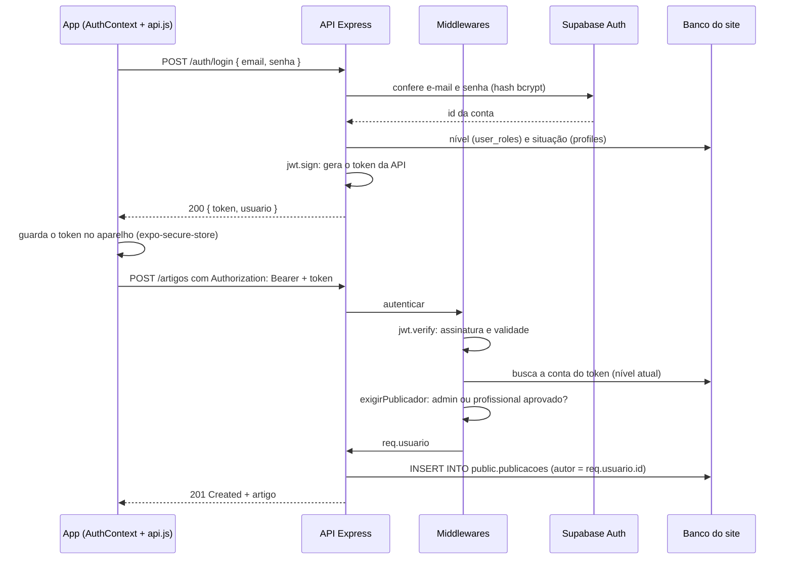

- Sem token, com token vencido ou adulterado: `autenticar` responde **401** e o app encerra a sessão.
- Token válido, mas o nível não permite a ação: **403**, e a tela mostra a mensagem da API.

### 3.2 Cadastro, login e proteção da senha

| Etapa | Onde | Como |
| --- | --- | --- |
| Cadastro | `POST /usuarios` → `usuariosController.cadastrar` → `services/supabaseAuth.js` | Valida os campos e cria a conta no **Supabase Auth**, que salva só o hash **bcrypt** da senha (coluna `auth.users.encrypted_password`). O gatilho `handle_new_user` do banco do site cria o perfil e o nível. E-mail repetido recebe 409; ninguém se cadastra como admin; conta profissional nasce `pendente`. Se o projeto exigir, o Supabase envia o e-mail de confirmação |
| Login | `POST /auth/login` → `authController.login` | O Supabase Auth compara a senha com o hash. Senha errada e e-mail inexistente recebem a mesma resposta (401), para não revelar quais e-mails têm conta. Conta suspensa no site recebe 403 |
| Token | `authController.login` → `utils/token.js` | Com a senha conferida, a **API** lê o nível e **gera o próprio JWT** (não usa o token do Supabase) |
| Respostas | `usuarioModel` | O hash nunca sai da API: as consultas não leem `encrypted_password` |

Por que o hash fica com o Supabase: as contas são as do site, e o site cria e confere senhas pelo Supabase Auth. Se
a API guardasse outra cópia da senha, as duas sairiam de sincronia (ex.: troca de senha pelo site).

### 3.3 O token JWT

Gerado em [`api/src/utils/token.js`](api/src/utils/token.js) com a biblioteca `jsonwebtoken`. Conteúdo de um token
(a parte do meio, decodificada):

```json
{ "nivel": "usuario", "iat": 1794222455, "exp": 1794827255, "sub": "6b1f0c2e-6a4d-4b8e-9d55-1f2a3b4c5d6e" }
```

- `sub` é o id da conta (o UUID do Supabase, o mesmo em todas as tabelas do site), `nivel` é o nível na hora do login e `exp` é a validade (`JWT_EXPIRES_IN`, padrão **7 dias**).
- O token é assinado com **HS256** e o segredo `JWT_SECRET`, que fica só no `api/.env` (fora do Git). Quem altera o
  conteúdo invalida a assinatura; sem o segredo, ninguém gera um token que a API aceite.
- A API não sobe sem um `JWT_SECRET` de pelo menos 32 caracteres. `npm run jwt:segredo` gera um aleatório e grava no `.env`.

### 3.4 Sessão no app

| O quê | Onde | Como |
| --- | --- | --- |
| Guardar o token | [`mobile/src/services/sessao.js`](mobile/src/services/sessao.js) | `expo-secure-store`, que criptografa os dados (Keystore no Android, Keychain no iOS). No Expo Web usa `localStorage`, só para testes |
| Enviar o token | [`mobile/src/services/api.js`](mobile/src/services/api.js) | Toda requisição de quem entrou leva `Authorization: Bearer <token>` |
| Continuar logado | [`mobile/src/contexts/AuthContext.js`](mobile/src/contexts/AuthContext.js) | Ao abrir, o app lê a sessão guardada (a tela de abertura espera) e confere o token em `GET /auth/perfil` |
| Sessão expirada | `api.js`, `AuthContext` e `App.js` | Se a API responder 401 a uma requisição feita com token, o app sai da conta e avisa *"Sua sessão expirou"*, com botão para entrar de novo |
| Logout | Minha conta → **Sair** | Pede confirmação e apaga o token do aparelho e da memória. As próximas requisições saem sem token |
| Atualizar a conta | `refreshUser` (ao abrir Minha conta) | `GET /auth/perfil` traz o nível e a situação atuais (ex.: cadastro profissional aprovado) |

O JWT não fica guardado no servidor (é *stateless*). Por isso o logout acontece no app, apagando o token, e a validade
limita o tempo de uso de um token que tenha ficado guardado em outro lugar.

### 3.5 Middlewares de autenticação e de nível

Em [`api/src/middlewares/`](api/src/middlewares):

| Middleware | O que confere | Se falhar |
| --- | --- | --- |
| `autenticar` | Token no formato `Bearer`, assinatura, validade e se a conta ainda existe. Deixa a conta em `req.usuario` | 401 |
| `autenticarSeHouverToken` | O mesmo, mas o token é opcional (contato, aberto a visitantes) | 401 se o token enviado for inválido |
| `permitirNiveis('admin')` | Nível da conta | 403 |
| `exigirPublicador` | Admin ou profissional **aprovado** | 403 |
| `proprioUsuarioOuAdmin` | O `:id` da rota é a própria pessoa, ou ela é admin | 403 |
| `autorDoArtigoOuAdmin` | Admin, ou autor do artigo que ainda pode publicar | 404 / 403 |
| `autorDoComentarioOuAdmin` | Admin, ou quem escreveu o comentário | 404 / 403 |

**O nível vem do banco, não só do token.** A cada requisição protegida, `autenticar` busca a conta pelo `sub` do
token. Assim, quando a administração aprova ou recusa um profissional (no app ou no site), a mudança vale na hora,
sem novo login, e uma conta apagada ou suspensa perde o acesso mesmo com um token ainda dentro da validade.

**A API conecta ao banco como dona dele**, então as regras de acesso do Supabase (RLS, usadas pelo site) não se
aplicam às consultas da API: quem aplica as mesmas regras são estes middlewares. Quando um gatilho do banco precisa
saber quem está agindo (ex.: só admin muda a verificação profissional), a API informa o id de quem está logado
(`comoUsuario`, em `config/database.js`).

**A identidade vem do token.** O app não envia mais `autorId` nem `usuarioId`; se alguém enviar, a API ignora.

### 3.6 Rotas protegidas e CRUD da entidade principal

Como fica no código ([`api/src/routes/artigos.routes.js`](api/src/routes/artigos.routes.js)):

```js
router.get('/', artigosController.listar); // aberta
router.get('/:slug', artigosController.buscar); // aberta
router.post('/', autenticar, exigirPublicador, artigosController.criar);
router.put('/:slug', autenticar, autorDoArtigoOuAdmin, artigosController.atualizar);
router.delete('/:slug', autenticar, autorDoArtigoOuAdmin, artigosController.excluir);
```

| Rota | Middlewares | Visitante | Família | Prof. em verificação | Prof. aprovado | Admin |
| --- | --- | :---: | :---: | :---: | :---: | :---: |
| `GET` de artigos, categorias, comentários, profissionais, colunas e revistas | — | ✅ | ✅ | ✅ | ✅ | ✅ |
| `POST /usuarios`, `POST /auth/login` | — | ✅ | ✅ | ✅ | ✅ | ✅ |
| `POST /mensagens` (contato) | `autenticarSeHouverToken` | ✅ | ✅ | ✅ | ✅ | ✅ |
| `POST /mensagens` (pergunta) | `autenticarSeHouverToken` | 401 | ✅ | ✅ | ✅ | ✅ |
| `GET /auth/perfil` | `autenticar` | 401 | ✅ | ✅ | ✅ | ✅ |
| `POST /artigos/:slug/comentarios`, `POST /artigos/:slug/interacoes`, `POST /colunas/:slug/posts/:postSlug/interacoes` | `autenticar` | 401 | ✅ | ✅ | ✅ | ✅ |
| `GET /usuarios/:id`, `GET /usuarios/:id/interacoes`, `DELETE /usuarios/:id` | `autenticar`, `proprioUsuarioOuAdmin` | 401 | a própria | a própria | a própria | ✅ |
| `DELETE /comentarios/:id` | `autenticar`, `autorDoComentarioOuAdmin` | 401 | os próprios | os próprios | os próprios | ✅ |
| `POST /artigos` | `autenticar`, `exigirPublicador` | 401 | 403 | 403 | ✅ | ✅ |
| `PUT /artigos/:slug`, `DELETE /artigos/:slug` | `autenticar`, `autorDoArtigoOuAdmin` | 401 | 403 | 403 | os próprios | ✅ |
| `GET /usuarios`, `PATCH /usuarios/:id/verificacao`, `/papel` e `/suspensao`, `PUT /revistas/:slug` | `autenticar`, `permitirNiveis('admin')` | 401 | 403 | 403 | 403 | ✅ |

**CRUD completo da entidade principal (`publicacoes`):**

| Operação | Rota | Tela do app | Quem pode |
| --- | --- | --- | --- |
| Criar | `POST /artigos` | Nova postagem | Profissional aprovado e admin |
| Ler | `GET /artigos`, `GET /artigos/:slug` | Início, Conteúdos, Artigo | Todos, inclusive visitantes |
| Atualizar | `PUT /artigos/:slug` | Editar artigo | Autor ou admin |
| Excluir | `DELETE /artigos/:slug` | Artigo e Minha conta | Autor ou admin |

Os **artigos de exemplo do site** (que o site guarda no próprio código, e não no banco) aparecem na lista, mas não
são editados. Excluir um deles (só admin) o registra em `conteudos_ocultos`, e ele some do app e do site. Quando o
admin exclui o artigo de outra pessoa, o motivo vai para `remocoes_publicacao`, e o site mostra o aviso ao autor.

No app, as telas continuam escondendo o que cada nível não pode fazer (seção 1.7), mas quem garante as regras é a
API: uma requisição feita fora do app, sem token ou com o nível errado, recebe 401 ou 403.

### 3.7 Testes

```bash
cd api
npm test
```

São 48 testes automatizados ([`api/tests/`](api/tests), com `node:test`). Eles **não usam o banco do site**: cada
arquivo de teste cria um PostgreSQL só dele, na memória, com o **PGlite** (o PostgreSQL de verdade rodando dentro do
Node, sem instalar nada). Esse banco recebe:

1. [`database/teste/supabase-simulado.sql`](database/teste/supabase-simulado.sql): as peças do Supabase que um
   PostgreSQL comum não tem (esquema `auth`, papéis, função `auth.uid()`);
2. as **migrations do site**, sem alteração: mesmas tabelas, gatilhos e funções do banco real;
3. [`database/teste/dados-teste.sql`](database/teste/dados-teste.sql): contas de teste (senha `123456`, só nesse
   banco temporário).

Como não há Supabase Auth nos testes, um substituto faz o mesmo trabalho direto no banco de teste (confere a senha
com o hash bcrypt e cria a conta em `auth.users`, disparando o gatilho do site). O que é testado:

- **Cadastro e senha:** a resposta não traz a senha nem o hash; `auth.users` guarda um hash bcrypt; o gatilho do site
  cria perfil e nível; conta profissional nasce pendente; e-mail repetido recebe 409; ninguém vira admin pelo cadastro.
- **Login e JWT:** 401 igual para senha errada e para e-mail inexistente; o token da API traz o id (UUID), o nível e
  a validade; admin entra com nível admin; conta suspensa não entra.
- **Validação do token:** sem token, fora do formato `Bearer`, adulterado (nível trocado para admin), assinado com
  outro segredo, vencido ou de conta apagada: sempre 401.
- **Níveis e CRUD:** visitante, família, profissional pendente, aprovado e recusado e admin, cada um recebendo
  200/201/204, 401 ou 403 conforme a tabela da seção 3.6. O artigo é gravado em `publicacoes`; curtidas e
  comentários, pelo slug; aprovação e recusa valem com o mesmo token; `autorId` ou `usuarioId` no corpo são ignorados.
- **Igual ao site:** artigos de exemplo não são editados e o admin os esconde (`conteudos_ocultos`); remoção pelo admin
  registra o aviso ao autor; contato respeita o limite de 3 mensagens por hora; colunas, revista e profissionais.
- **Administração (página "Usuários" do site):** só o admin lista contas, muda papéis e suspende; o admin não tira a
  própria permissão nem suspende a própria conta; conta suspensa perde o acesso na hora e volta ao ser reativada;
  a pessoa exclui a própria conta confirmando com EXCLUIR (e os dados dela somem junto); a única conta de
  administração não pode ser excluída; o admin edita título e sinopse das edições do banco, e as de exemplo não mudam.

Exemplos para testar à mão (com o token) estão em [`api/requests.http`](api/requests.http). Atenção: esses usam a
API ligada ao banco real.


---

## 4. Finalização, testes e APK (Entrega 4)

### 4.1 Testes realizados

**API (automáticos):** `cd api && npm test` roda 48 testes contra a API, com um banco igual ao do site (detalhes na
seção 3.7). Resultado atual: **48 de 48 passando**.

**App (roteiro por nível):** cada cenário abaixo foi executado no app ligado à API real (versão com MySQL; ⏳ repetir
com o banco do site depois de configurar o `api/.env`), com o navegador controlado
pelo Playwright (versão web do Expo) e checagem de erros de página, de console e de respostas da API.

| Área | Cenário | Nível | Resultado |
| --- | --- | --- | :---: |
| Navegação | Início, Conteúdos (busca, colunas, revista), Artigo, Coluna, Profissionais, Perfil, Comunidade, Sobre e Contato | Visitante | ✅ |
| Navegação | Boas-vindas cabe na tela sem rolar (360 × 640) | Visitante | ✅ |
| Cadastro | Criar conta de família e entrar em seguida | Visitante | ✅ |
| Cadastro | Criar conta profissional: fica "em verificação" e sem *Nova postagem* | Profissional pendente | ✅ |
| Login | Token guardado no aparelho e enviado como Bearer Token | Todos | ✅ |
| Sessão | Continua logado ao reabrir o app | Todos | ✅ |
| Sessão | Token inválido ou vencido: sai da conta e avisa *"Sua sessão expirou"* | Todos | ✅ |
| Logout | *Sair* pede confirmação e apaga o token | Todos | ✅ |
| Permissões | Curtir, salvar e comentar sem conta pedem login | Visitante | ✅ |
| Permissões | Família não vê editar/excluir artigo, *Nova postagem* nem *Novos profissionais* | Família | ✅ |
| Permissões | Admin aprova o cadastro e o profissional passa a publicar **sem sair da conta** | Admin → Profissional | ✅ |
| Comunidade | Comentar, excluir o próprio comentário, curtir, salvar e perguntar à equipe | Família | ✅ |
| CRUD | Publicar, ver, editar e excluir artigo (o autor vem do token) | Profissional aprovado | ✅ |
| Administração | *Novos profissionais*: lista e filtros (a analisar, aprovados, recusados) | Admin | ✅ |
| Conexão | Endereço errado não é salvo; endereço certo é salvo e vale ao reabrir; voltar ao padrão | Todos | ✅ |

**No celular:** ⏳ falta repetir o roteiro no [APK instalado](https://expo.dev/accounts/anasprenger/projects/conexao-pais/builds/fc657781-6d4f-4db7-8096-564304ab2395), com a API rodando no notebook (seção 4.4).

### 4.2 O que mudou nesta etapa

- **APK com EAS Build:** [`mobile/eas.json`](mobile/eas.json) com o perfil `preview`, que gera um `.apk` instalável.
- **HTTP liberado no Android:** o Android bloqueia conexões sem criptografia por padrão, e a API roda no notebook em
  `http://IP:3333`. O plugin `expo-build-properties` liga `usesCleartextTraffic` (conferido no `AndroidManifest.xml`
  gerado).
- **Endereço da API configurável no app:** o IP do notebook muda de uma rede Wi-Fi para outra (casa, faculdade). Na
  tela **Conexão com a API** (ícone no canto da tela de Boas-vindas ou em *Minha conta*), basta digitar o IP; o app
  testa a conexão e só salva se a API responder. Não precisa gerar outro APK.
- **A API mostra o endereço para o celular** ao subir (`npm run dev`).
- **Ajustes iguais aos do site (18/11):**
  - **Revista:** o título vem sempre do campo título, e a sinopse aparece só embaixo, separada em texto e tópicos.
    Antes, a sinopse aparecia no lugar do título e se repetia. Início e Conteúdos recarregam ao voltar para a tela,
    então um título editado aparece em todas as telas.
  - **Colunas:** sem comentários (só os artigos têm). Cada publicação da coluna pode ser curtida e salva. As salvas
    aparecem em *Minha conta*, junto com os artigos.
  - **Minha conta:** além dos artigos, a administração vê as edições da revista com o botão **Editar**.
  - **Senha:** o botão de mostrar e ocultar a senha já existia no app, no login e no cadastro.
  - **Leitura da revista dentro do app:** nas edições publicadas pelo site (que têm só o PDF), *Começar a leitura*
    abria o PDF no navegador. Agora o PDF abre no modo de leitura do app, como no site: uma página por vez, ocupando
    a tela, com toque à direita para avançar, à esquerda para voltar e barra de progresso. O PDF é desenhado pelo
    pdf.js (a mesma biblioteca do site) numa WebView (`react-native-webview`), no componente
    [`LeitorPdf`](mobile/src/components/LeitorPdf.js). *Baixar PDF* continua abrindo o arquivo.
  - O **painel de interações** é só do site. A migration dele foi copiada para `database/supabase/migrations/`, para a
    estrutura do banco continuar igual à do site.

| Conexão com a API |
| --- |
| 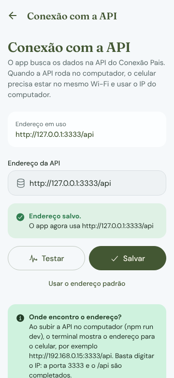 |

### 4.3 Como gerar o APK

**APK da versão final:** [baixar no Expo](https://expo.dev/accounts/anasprenger/projects/conexao-pais/builds/fc657781-6d4f-4db7-8096-564304ab2395) (abra o link no celular Android ou leia o QR Code da
página). Gerado com `npm run build:apk` a partir da versão atual do repositório.

O APK é compilado nos servidores da Expo (EAS Build, gratuito). Precisa de uma conta em
[expo.dev](https://expo.dev/signup).

1. Instale o EAS CLI e entre na conta (uma vez só):

   ```bash
   npm install -g eas-cli
   ```

   ```bash
   eas login
   ```

2. (Opcional) Em [`mobile/eas.json`](mobile/eas.json), troque `EXPO_PUBLIC_API_URL` pelo IP do notebook. É só o
   endereço padrão: dá para mudar depois, dentro do app.

3. Gere o APK:

   ```bash
   cd mobile
   npm run build:apk
   ```

   Na primeira vez, o EAS pergunta se pode criar o projeto na sua conta e uma chave de assinatura Android: responda
   **sim** (Y) nas duas. A compilação leva de 10 a 20 minutos e, no fim, mostra um link e um QR Code para baixar o
   `.apk`.

4. No celular Android, abra o link, baixe o arquivo e instale (o Android pede para permitir a instalação de apps
   desta fonte).

### 4.4 Usando o APK com a API no notebook

1. No notebook (com internet: o banco fica no Supabase), suba a API:

   ```bash
   cd api
   npm run dev
   ```

   O terminal mostra *"No celular (mesmo Wi-Fi), use em 'Conexão com a API': http://192.168.x.x:3333/api"*. No
   Windows, use o endereço do **Wi-Fi** (em geral começa com 192.168 ou 10.); ignore os que começam com 172. (redes
   virtuais). Na dúvida, confira com `ipconfig`.

2. Celular e notebook no **mesmo Wi-Fi**. Se o Windows perguntar, permita o Node.js em **redes privadas** no firewall.

3. No app: ícone de servidor na tela de Boas-vindas → digite o IP → **Testar** → **Salvar**.

Se não conectar: abra `http://IP_DO_NOTEBOOK:3333/api/status` no navegador do celular. Se não abrir, o problema está
na rede ou no firewall, não no app. Redes de faculdade às vezes bloqueiam a comunicação entre aparelhos; nesse caso,
use o roteador do celular (o notebook se conecta no Wi-Fi do celular).

### 4.5 Apresentação

O roteiro da apresentação, com a demonstração passo a passo e as explicações de JWT, hash, Bearer Token e
middleware, está em [`docs/apresentacao.md`](docs/apresentacao.md). Os slides (15, na mesma ordem do roteiro) estão em
[`docs/apresentacao.pdf`](docs/apresentacao.pdf).

---

## 5. Versão atual do app

| Boas-vindas | Início | Conteúdos | Artigo |
| --- | --- | --- | --- |
|  |  | 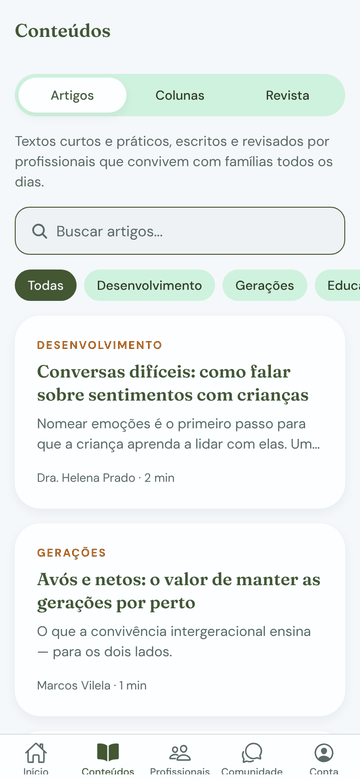 | 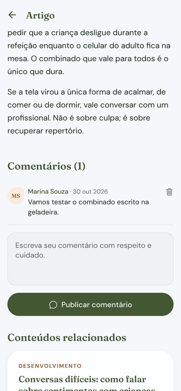 |

| Revista | Perfil profissional | Comunidade | Minha conta |
| --- | --- | --- | --- |
| 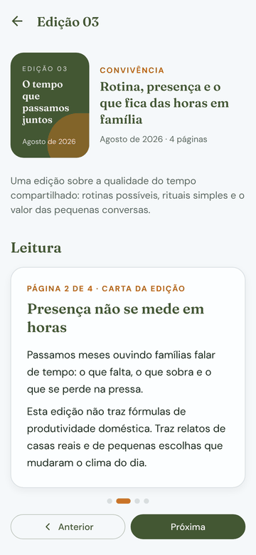 |  | 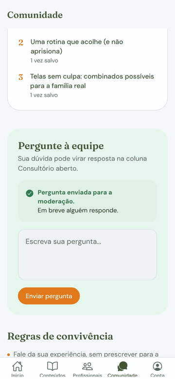 | 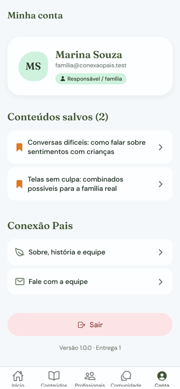 |

| Criar conta (profissional) | Novos profissionais (admin) | Nova postagem | Artigo publicado |
| --- | --- | --- | --- |
| 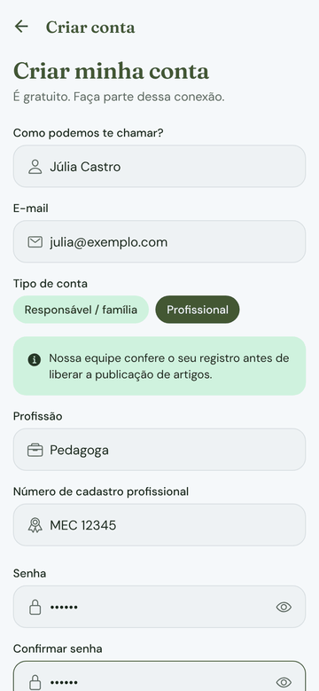 | 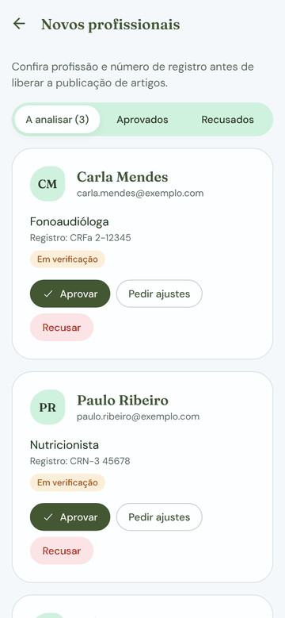 | 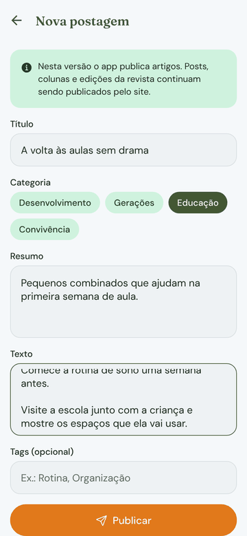 | 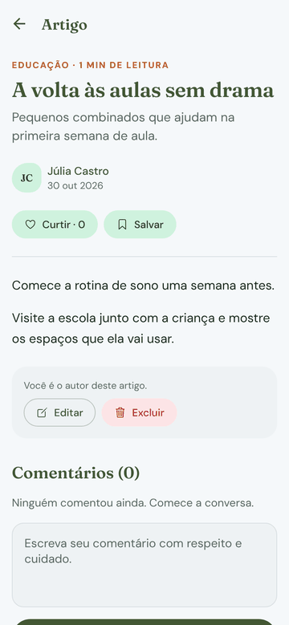 |

Entrega 3 (sessão com JWT):

| Sair da conta (logout) | Token vencido: aviso | Entrar de novo |
| --- | --- | --- |
| 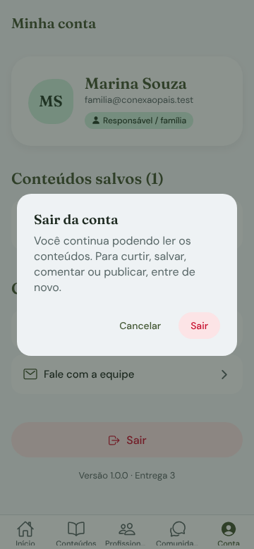 |  | 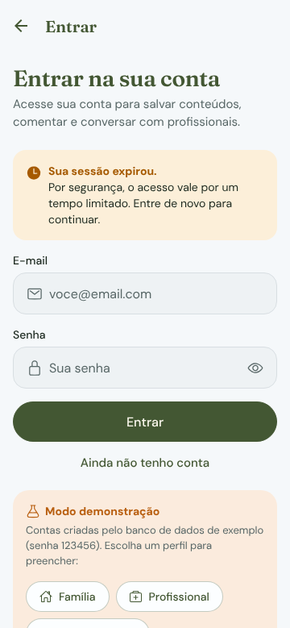 |

**O que já funciona:**

- 17 telas com React Navigation 7 (stack raiz + abas inferiores) e a identidade visual do site;
- telas e ações diferentes para cada nível (família, profissional em verificação, profissional aprovado e admin);
- visitantes leem tudo sem conta; para curtir, salvar, comentar ou perguntar, o app pede login;
- **todos os dados vêm do banco do site pela API**, com `fetch()`: cadastro, login, artigos (CRUD completo),
  comentários, curtidas, salvos, colunas, revista, profissionais, mensagens e verificação de profissionais;
- **mesmas contas e publicações do site**: o que é feito no app aparece no site, e vice-versa;
- estados de carregamento e de erro em todas as telas, com opção de tentar de novo;
- validação nos formulários e na API, com os erros da API mostrados no campo certo;
- **login com JWT**: o token fica guardado no aparelho, vai em toda requisição como Bearer Token e mantém a pessoa
  logada ao reabrir o app; logout apaga o token; token vencido encerra a sessão com aviso;
- **permissões garantidas pela API**: middlewares conferem o token e o nível em cada rota protegida (seção 3);
- **pronto para o APK**: HTTP liberado para a API local e endereço da API configurável dentro do app (seção 4).

### Contas de demonstração

São as **contas de teste do site** (as mesmas no app). Na tela **Entrar**, os botões do *Modo demonstração*
preenchem o e-mail; a senha é a das contas de teste do site e **não fica no repositório**, que é público.

| Perfil | E-mail |
| --- | --- |
| Família | `familia@conexaopais.test` |
| Profissional aprovado (Dra. Helena Prado) | `profissional@conexaopais.test` |
| Administração | `admin@conexaopais.test` |

Para ver o fluxo completo de níveis: crie uma conta **Profissional** (com um e-mail seu, se o projeto pedir
confirmação), entre com ela (fica em verificação), entre como **Administração** e aprove o cadastro em
*Minha conta → Novos profissionais*, depois volte à conta profissional e publique um artigo. O artigo aparece também
no site.

---

## 6. Tecnologias

| Camada | Tecnologia |
| --- | --- |
| App | React Native 0.88 + Expo SDK 58 (JavaScript) |
| Navegação | React Navigation 7 (`native-stack` e `bottom-tabs`) |
| Leitura da revista (PDF) | `react-native-webview` + pdf.js (o mesmo leitor de PDF do site) |
| Comunicação | `fetch()` com JSON e Bearer Token (camada `src/services`) e `expo-constants` para achar o IP da API |
| Sessão no aparelho | `expo-secure-store` (token e endereço da API, criptografados) |
| Build do APK | EAS Build (`eas.json`) e `expo-build-properties` (HTTP liberado para a API local) |
| Visual | `@expo/vector-icons` (Ionicons), `expo-font` com Fraunces e DM Sans (`@expo-google-fonts`) |
| Estado | React Context (autenticação, artigos, comunidade, confirmação) e hook `useApi` |
| API | Node.js 20+ e Express 5 (`cors`, `dotenv`) |
| Banco | PostgreSQL do Supabase (o mesmo do site) com `pg` (pool de conexões e consultas parametrizadas) |
| Contas e senhas | Supabase Auth (contas do site; hash bcrypt), chamado pela API com `fetch()` |
| Autenticação do app | JWT com `jsonwebtoken` (HS256), gerado pela API e enviado como Bearer Token |
| Testes da API | `node:test` (embutido no Node.js) e PGlite (PostgreSQL em memória, só para os testes) |

## 7. Estrutura do repositório

```
conexaopais.app/
├── README.md
├── database/
│   ├── supabase/migrations/  # estrutura do banco do site (cópia das migrations do repositório do site)
│   └── teste/                # Supabase simulado e contas de teste (só para npm test)
├── api/                      # API REST (Node.js + Express)
│   ├── .env.example          # modelo de configuração (o .env real não vai para o Git)
│   ├── requests.http         # exemplos de requisições (login e rotas com Bearer Token)
│   ├── scripts/
│   │   ├── conferir-banco.js # npm run db:conferir: confere o .env, o banco e o Supabase Auth
│   │   └── gerar-segredo.js  # npm run jwt:segredo: grava um JWT_SECRET aleatório no .env
│   ├── tests/                # npm test: cadastro, JWT, níveis, CRUD e conteúdos (banco em memória)
│   └── src/
│       ├── server.js         # confere o .env e sobe o servidor na porta 3333
│       ├── app.js            # Express, CORS, JSON, rotas e tratamento de erros
│       ├── config/           # conexão com o PostgreSQL do Supabase (pool)
│       ├── data/             # conteúdos de exemplo do site (cópia do mock.ts do site)
│       ├── services/         # supabaseAuth.js (login e cadastro) e armazenamento.js (PDFs da revista)
│       ├── routes/           # endereços da API e os middlewares de cada rota
│       ├── middlewares/      # autenticacao.js (JWT), permissoes.js (níveis) e erros
│       ├── controllers/      # validação, regras e respostas HTTP
│       ├── models/           # consultas SQL nas tabelas do site
│       └── utils/            # token.js (gera e confere o JWT), validação e texto
├── docs/
│   ├── apresentacao.md       # roteiro da apresentação e defesa
│   ├── apresentacao.pdf      # slides da apresentação
│   ├── banco-de-dados.md     # dicionário de dados (todos os campos)
│   └── telas/                # imagens das telas usadas neste README
└── mobile/                   # aplicativo React Native (Expo)
    ├── App.js                # fontes, provedores de contexto e NavigationContainer
    ├── app.json              # nome, ícone, splash, pacote Android (app.conexaopais) e plugins
    ├── eas.json              # perfis de build do EAS (preview = APK)
    ├── .env.example          # EXPO_PUBLIC_API_URL (opcional)
    ├── assets/               # logo da árvore, ícones, splash e fotos do site
    └── src/
        ├── services/         # api.js (fetch + Bearer Token), sessao.js e configuracao.js (dados no aparelho) e serviços por recurso
        ├── hooks/            # useApi (carregando / erro / recarregar)
        ├── components/       # Button, TextField, ArticleCard, AsyncState...
        ├── contexts/         # AuthContext, ContentContext (CRUD de artigos), CommunityContext...
        ├── data/             # textos institucionais fixos (Sobre e Comunidade)
        ├── navigation/       # RootNavigator (stack por nível), AppTabs (abas) e tema
        ├── screens/          # auth/, app/, publish/ e admin/
        ├── theme/            # cores, fontes, espaçamentos e estilos de texto do site
        └── utils/            # validações e funções de texto
```

## 8. Como executar

Pré-requisitos: [Node.js](https://nodejs.org) 20 ou superior, acesso ao projeto **conexao-pais** no
[Supabase](https://supabase.com/dashboard) (o banco do site), internet no computador da API e o app **Expo Go** no
celular. O celular e o computador precisam estar **na mesma rede Wi-Fi**. Não é preciso instalar banco de dados.

### 8.1 API (ligada ao banco do site)

```bash
cd api
npm install
```

Copie `api/.env.example` para `api/.env` e preencha com os dados do projeto no Supabase:

| Variável | Onde pegar no painel do Supabase |
| --- | --- |
| `DATABASE_URL` | Botão **Connect** → aba *Connection String* → **Session pooler**. Troque `[YOUR-PASSWORD]` pela senha do banco (*Project Settings → Database*; se não lembrar, dá para redefinir lá) |
| `SUPABASE_URL` | *Project Settings → API* → Project URL (`https://<id>.supabase.co`) |
| `SUPABASE_PUBLISHABLE_KEY` | *Project Settings → API Keys* → chave **publishable** (a mesma que o site usa; é pública) |
| `SITE_URL` | Endereço do site (`https://conexaopais.com`) |

> Use o **Session pooler**, e não o *Direct connection*: a conexão direta do Supabase só funciona em redes com IPv6,
> e a maioria das redes de casa e de faculdade usa IPv4.

O `.env` tem a senha do banco: **nunca envie esse arquivo para o Git** (ele já está no `.gitignore`).

Gere o segredo que assina os tokens JWT do app (ele é gravado no `.env`):

```bash
npm run jwt:segredo
```

Confira se está tudo certo (só lê, não altera nada):

```bash
npm run db:conferir
```

Deve aparecer *"✔ Banco do site conectado"* e *"✔ Supabase Auth respondendo"*. Se algo falhar, a mensagem diz o
motivo (senha do banco, endereço do pooler, chave do Supabase).

Suba a API (ela reinicia sozinha quando o código muda):

```bash
npm run dev
```

Teste no navegador: <http://localhost:3333/api/status> deve mostrar `{"api":"ok","banco":"ok"}`.

Testes automatizados (usam um banco em memória, não precisam do `.env` e não mexem nos dados do site):

```bash
npm test
```

> **Atualizando da versão com MySQL** (`git pull` ou troca de branch): rode `npm install` de novo em `api/` (saíram
> `mysql2` e `bcryptjs`, entrou `pg`) e preencha as variáveis novas do `.env`. O MySQL não é mais usado.

### 8.2 App

Em outro terminal:

```bash
cd mobile
npm install
npx expo start
```

Leia o QR Code com o Expo Go. O app encontra a API sozinho, usando o IP do computador que está rodando o Expo, na
porta 3333. Se o app mostrar *"Não foi possível conectar à API"*:

- confira se a API está rodando e se o celular está no mesmo Wi-Fi;
- libere a porta **3333** no firewall do computador (no Windows, permita o Node.js em redes privadas);
- ou informe o endereço no próprio app, em **Conexão com a API** (ícone na tela de Boas-vindas ou em *Minha conta*);
- ou crie `mobile/.env` com `EXPO_PUBLIC_API_URL=http://IP_DO_COMPUTADOR:3333/api` e reinicie com `npx expo start -c`.

No navegador do computador: `npx expo start --web`. Para gerar o APK, veja a seção 4.3.

---

## 9. Entrega final

Checklist das entregas obrigatórias do PDF:

| Item | Onde | Situação |
| --- | --- | :---: |
| Link do repositório atualizado | este repositório | ✅ |
| Código-fonte completo | `mobile/` e `api/` | ✅ |
| API e scripts necessários | `api/` (`npm run jwt:segredo`, `db:conferir`, `dev`, `test`) | ✅ |
| README atualizado | este arquivo | ✅ |
| Script SQL / estrutura do banco | `database/supabase/migrations/` (banco do site), `docs/banco-de-dados.md` | ✅ |
| APK final | [baixar no Expo](https://expo.dev/accounts/anasprenger/projects/conexao-pais/builds/fc657781-6d4f-4db7-8096-564304ab2395) (EAS Build, perfil `preview`; seção 4.3) | ✅ |
| Material da apresentação | `docs/apresentacao.md` e `docs/apresentacao.pdf` | ✅ |

Antes de entregar: o APK precisa ser gerado a partir da mesma versão que está no repositório (faça o build depois do
último commit e push).

## Autoria

Desenvolvido por **Ana Elisa Sprenger** ([@anasprenger](https://github.com/anasprenger)).
