# Conexão Pais — App

> **Ajudando a unir famílias e gerações.**

Versão mobile do portal **Conexão Pais** ([conexaopais.com.br](https://conexaopais.com.br)): artigos, colunas, revista
digital, profissionais parceiros e comunidade para quem cuida, educa e acompanha crianças e adolescentes.

Projeto avaliativo da disciplina de Aplicações Mobile (React Native + API REST + MySQL + JWT), desenvolvido em
4 entregas incrementais.

| Entrega | Conteúdo | Situação |
| --- | --- | --- |
| **1** | Problema, proposta, projeto Expo, telas, navegação e repositório | ✅ Entregue |
| 2 | Modelagem, MySQL, API Express, integração com `fetch()` | ⏳ Próxima etapa |
| 3 | Cadastro, login, hash de senha, JWT, níveis de usuário e CRUD completo | ⏳ |
| 4 | Testes, correções, README final, APK e apresentação | ⏳ |

---

## 1. Proposta do projeto (Entrega 1)

### 1.1 Problema atual identificado

Quem cuida de crianças e adolescentes tem dúvidas todos os dias: desenvolvimento, sono, escola, telas, limites,
convivência com os avós. Informação existe de sobra, mas está **espalhada, nem sempre é confiável** e muitas vezes
vem cheia de jargão ou de julgamento. Na prática, quem cuida costuma **se sentir sozinho ao decidir**.

> *"Cuidar dá trabalho. Encontrar boa informação não deveria dar."*

> **Pergunta orientadora:** como uma aplicação mobile pode reunir informação confiável, acolhimento e contato com
> profissionais em um só lugar para quem cuida?

### 1.2 Contexto e público afetado

- **Público principal:** pais, mães, avós e outros responsáveis, em todas as configurações de família.
- **Profissionais parceiros:** psicólogos, pediatras, pedagogos, terapeutas familiares e outras pessoas que
  atendem famílias e querem publicar conteúdo de qualidade.
- **Afetados indiretamente:** crianças e adolescentes, que ganham adultos mais bem informados e mais tranquilos
  para conversar.

O projeto já existe como portal web (site Conexão Pais). O app leva esse ecossistema para o celular, que é onde a
dúvida aparece: no carro, na fila da escola, na hora de dormir.

### 1.3 Justificativa

- **Credibilidade:** o conteúdo é escrito e revisado por profissionais, com autoria visível.
- **Acolhimento:** linguagem clara, sem jargão e sem julgamento, pensada para diferentes arranjos familiares.
- **Rede de apoio:** a comunidade (curtir, salvar, comentar, perguntar à equipe) e o diretório de profissionais
  verificados mostram que ninguém precisa cuidar sozinho.
- **Segurança:** só profissionais com registro conferido pela administração podem publicar.
- **Por que um app:** consulta rápida no momento da dúvida, conteúdos salvos sempre à mão e, futuramente, avisos
  de novas colunas e edições da revista.
- **ODS 4 (Educação de Qualidade):** educação não formal e aprendizagem ao longo da vida para famílias.

### 1.4 Proposta de solução

O **app Conexão Pais** reúne, no celular, as seções do portal:

1. **Conteúdos:** artigos, colunas assinadas e a revista digital (leitura página a página).
2. **Profissionais:** diretório com especialidade, cidade, forma de atendimento e contato por WhatsApp.
3. **Comunidade:** curtidas, conteúdos salvos, comentários nos artigos, perguntas à equipe e regras de convivência.
4. **Área de publicação:** profissionais aprovados e a administração publicam, editam e excluem artigos.
5. **Administração:** verificação de novos profissionais (aprovar, pedir ajustes ou recusar) e moderação.

A **entidade principal** é a **Publicação (artigo)**. É ela que terá CRUD completo integrado à API e ao MySQL nas
próximas entregas, assim como a tabela `publicacoes` do site.

### 1.5 Nome da aplicação

**Conexão Pais**, o mesmo nome do portal, com o slogan *"Ajudando a unir famílias e gerações."*

### 1.6 Tipos de usuário

Os níveis são os mesmos do site (`app_role`):

| Tipo | Nível | Quem é |
| --- | --- | --- |
| **Visitante** | — | Pessoa ainda não autenticada |
| **Família** | `usuario` | Pai, mãe, avó/avô ou outro responsável |
| **Profissional** | `profissional` | Profissional parceiro. Começa **em verificação** e só publica depois de **aprovado** pela administração |
| **Administração** | `admin` | Equipe do Conexão Pais (curadoria, moderação e verificação) |

Situações do cadastro profissional: `pendente` → `aprovado`, `ajustes_solicitados` ou `recusado`.

### 1.7 Permissões iniciais

| Ação | Visitante | Família | Profissional em verificação | Profissional aprovado | Admin |
| --- | :---: | :---: | :---: | :---: | :---: |
| Ver boas-vindas, entrar e criar conta | ✅ | — | — | — | — |
| Ler artigos, colunas e revista | ❌ | ✅ | ✅ | ✅ | ✅ |
| Ver profissionais e chamar no WhatsApp | ❌ | ✅ | ✅ | ✅ | ✅ |
| Curtir, salvar e comentar | ❌ | ✅ | ✅ | ✅ | ✅ |
| Excluir o próprio comentário | ❌ | ✅ | ✅ | ✅ | ✅ |
| Publicar artigo | ❌ | ❌ | ❌ | ✅ | ✅ |
| Editar e excluir artigo | ❌ | ❌ | ❌ | só os próprios | todos |
| Excluir comentário de outra pessoa | ❌ | ❌ | ❌ | ❌ | ✅ |
| Aprovar, pedir ajustes ou recusar profissionais | ❌ | ❌ | ❌ | ❌ | ✅ |

São as mesmas regras do banco do site (políticas da tabela `publicacoes`: *"Admin e profissional aprovado
criam"*, *"Autor ou admin edita"*, *"Autor ou admin remove"*). Na Entrega 3 elas serão garantidas **no back-end**
por middleware de autenticação (JWT enviado como Bearer Token) e de autorização por nível.

### 1.8 Principais funcionalidades

1. Cadastro com tipo de conta (família ou profissional, com profissão e número de registro) e login.
2. Início com destaques: artigo em destaque, revista atual, profissionais, colunas e "Como funciona".
3. Artigos com busca e filtro por categoria; leitura com curtir, salvar e comentários.
4. Colunas assinadas e revista digital com leitor página a página.
5. Diretório de profissionais com busca, filtro por especialidade e contato por WhatsApp.
6. Comunidade: conversas em andamento, destaques (mais curtidos e mais salvos), pergunta à equipe e regras.
7. Minha conta: dados e nível do usuário, situação do cadastro profissional, conteúdos salvos e logout.
8. Área de publicação: criar, editar e excluir artigos, conforme o nível.
9. Administração: verificação de novos profissionais.
10. Sobre (valores, história e equipe) e Contato.

### 1.9 Telas previstas

Todas as telas abaixo já existem nesta primeira versão navegável (com dados de exemplo).

| # | Tela | Acesso | Descrição |
| --- | --- | --- | --- |
| 1 | Boas-vindas | Visitante | Apresentação, foto da família e acesso a Entrar / Criar conta |
| 2 | Entrar | Visitante | E-mail e senha (+ perfis de demonstração) |
| 3 | Criar conta | Visitante | Nome, e-mail, tipo de conta, profissão/registro (profissional) e senha |
| 4 | Início | Logado | Saudação, destaques e atalhos |
| 5 | Conteúdos | Logado | Artigos (busca e categorias), Colunas e Revista |
| 6 | Artigo | Logado | Leitura, curtir, salvar, comentários e conteúdos relacionados |
| 7 | Coluna | Logado | Apresentação da coluna e publicações |
| 8 | Revista | Logado | Capa, destaques e leitor página a página |
| 9 | Profissionais | Logado | Diretório com busca e filtro por especialidade |
| 10 | Perfil profissional | Logado | Dados, contato por WhatsApp, conteúdos e colunas |
| 11 | Comunidade | Logado | Recursos, conversas, destaques, pergunta à equipe e regras |
| 12 | Minha conta | Logado | Perfil, nível, salvos, publicações e administração |
| 13 | Sobre | Logado | Valores, como surgiu e equipe |
| 14 | Contato | Logado | Formulário de mensagem para a equipe |
| 15 | Nova postagem / Editar artigo | Profissional aprovado e admin | Formulário do artigo |
| 16 | Novos profissionais | Somente admin | Aprovar, pedir ajustes ou recusar cadastros |

### 1.10 Fluxo inicial de navegação

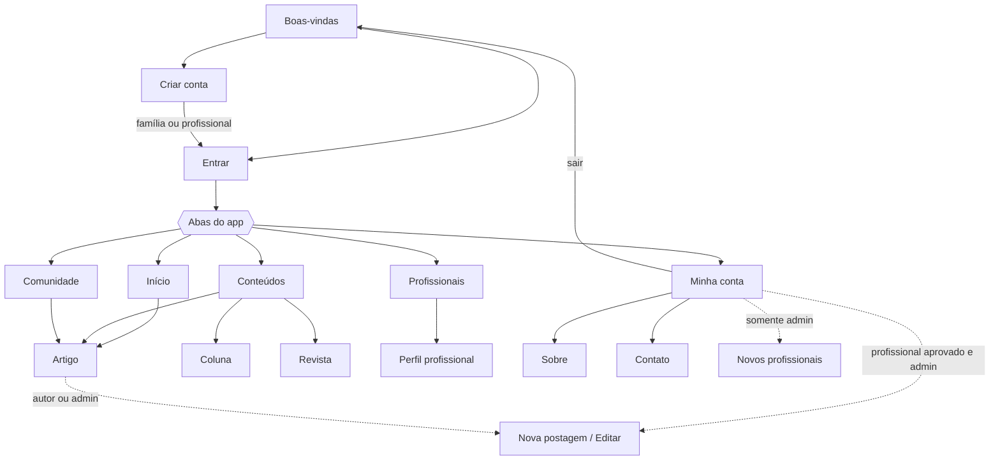

**Como a navegação está organizada (React Navigation):**

- **Stack raiz** (`native-stack`): mostra só as telas públicas quando não há usuário logado. Depois do login,
  registra as telas de leitura e, **conforme o nível**, a área de publicação (`canPublish`) e a verificação de
  profissionais (`isAdmin`). Uma tela que não foi registrada não pode ser aberta.
- **Abas inferiores** (`bottom-tabs`): Início, Conteúdos, Profissionais, Comunidade e Minha conta.
- **Telas empilhadas sobre as abas:** Artigo, Coluna, Revista, Perfil profissional, Sobre, Contato, Nova postagem e
  Novos profissionais.

---

## 2. Primeira versão do app

| Boas-vindas | Início | Conteúdos | Artigo |
| --- | --- | --- | --- |
|  | 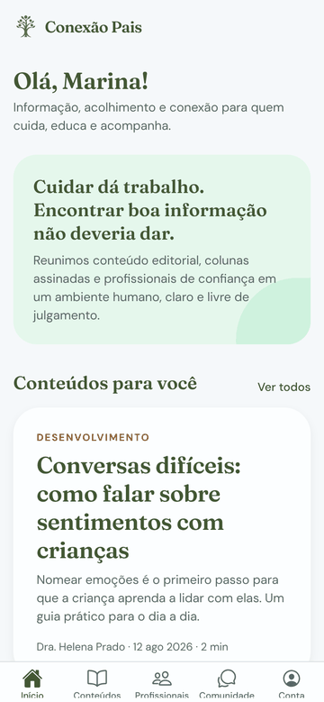 | 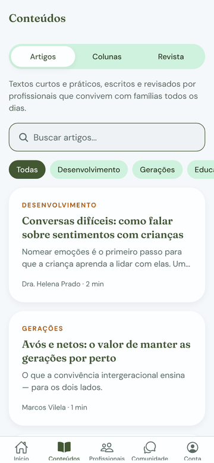 | 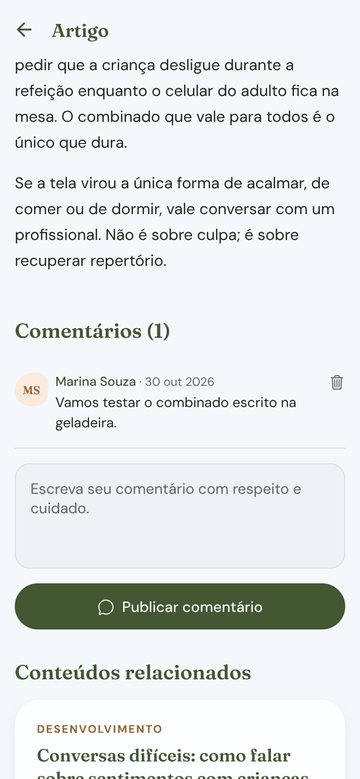 |

| Revista | Perfil profissional | Comunidade | Minha conta |
| --- | --- | --- | --- |
| 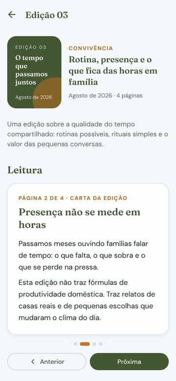 |  | 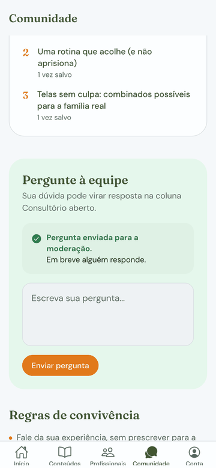 | 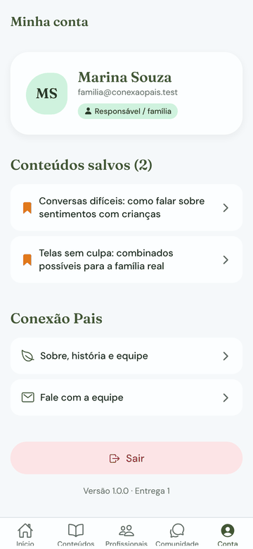 |

| Criar conta (profissional) | Novos profissionais (admin) | Nova postagem | Artigo publicado |
| --- | --- | --- | --- |
| 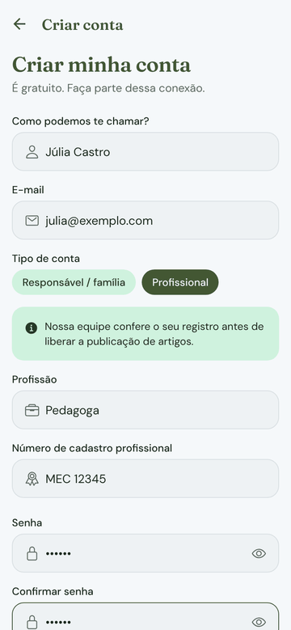 | 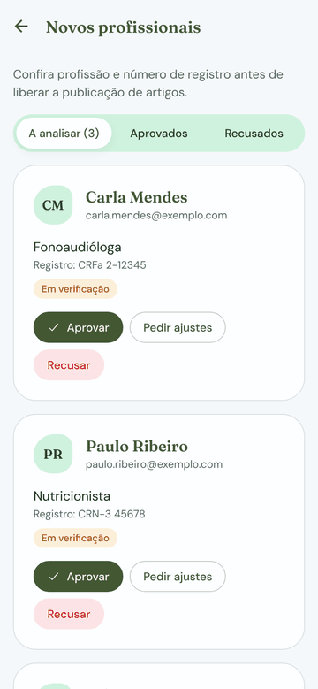 | 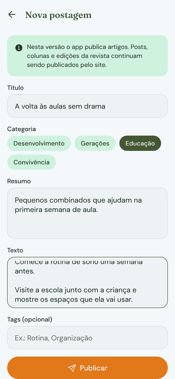 | 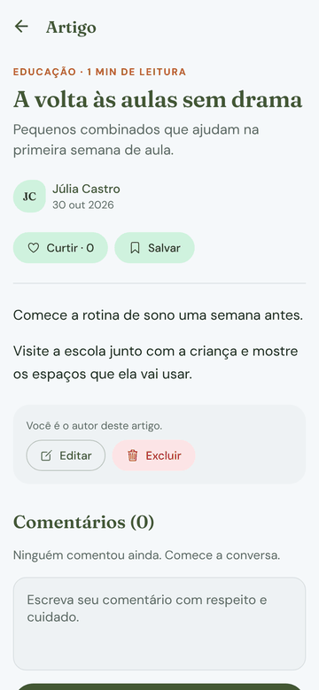 |

**O que já funciona nesta entrega:**

- projeto Expo (SDK 58) com React Navigation 7: stack raiz + abas inferiores + telas empilhadas;
- 16 telas navegáveis com a identidade visual do site: logo da árvore, verde musgo e ocre, fontes Fraunces e
  DM Sans;
- telas e ações diferentes para cada nível (família, profissional em verificação, profissional aprovado e admin);
- validação dos formulários (cadastro, login, comentário, publicação, contato);
- conteúdo de exemplo trazido do site (artigos, colunas, revistas, profissionais e equipe).

**Ainda simulado (próximas entregas):** o login aceita qualquer senha com 6 ou mais caracteres e os dados ficam em
memória, voltando ao início quando o app é reiniciado. API, MySQL, hash de senha e JWT entram nas Entregas 2 e 3.

### Contas de demonstração

Na tela **Entrar**, os botões do *Modo demonstração* preenchem estas contas (as mesmas contas de teste do site):

| Perfil | E-mail | Senha |
| --- | --- | --- |
| Família | `familia@conexaopais.test` | `123456` |
| Profissional aprovado (Dra. Helena Prado) | `profissional@conexaopais.test` | `123456` |
| Administração | `admin@conexaopais.test` | `123456` |

Para ver o fluxo completo de níveis: crie uma conta **Profissional**, entre com ela (fica em verificação), entre
como **Administração** e aprove o cadastro em *Minha conta → Novos profissionais*, depois entre de novo com a conta
profissional e publique um artigo.

---

## 3. Tecnologias

| Camada | Tecnologia |
| --- | --- |
| App | React Native 0.88 + Expo SDK 58 (JavaScript) |
| Navegação | React Navigation 7 (`native-stack` e `bottom-tabs`) |
| Visual | `@expo/vector-icons` (Ionicons), `expo-font` com Fraunces e DM Sans (`@expo-google-fonts`) |
| Estado | React Context (autenticação, conteúdos, comunidade, confirmação) |
| API (Entrega 2) | Node.js + Express |
| Banco (Entrega 2) | MySQL |
| Autenticação (Entrega 3) | bcrypt (hash) + JWT (Bearer Token) |

## 4. Estrutura do repositório

```
conexaopais.app/
├── README.md
├── docs/telas/               # imagens das telas usadas neste README
└── mobile/                   # aplicativo React Native (Expo)
    ├── App.js                # fontes, provedores de contexto e NavigationContainer
    ├── app.json              # nome, ícone, splash e pacote Android (app.conexaopais)
    ├── assets/               # logo da árvore, ícones, splash e fotos do site
    └── src/
        ├── components/       # Button, TextField, ArticleCard, ProfessionalCard, MagazineCover...
        ├── contexts/         # AuthContext (níveis e permissões), ContentContext (CRUD de artigos),
        │                     # CommunityContext (curtidas, salvos, comentários), ConfirmContext
        ├── data/             # conteúdo de exemplo trazido do site
        ├── navigation/       # RootNavigator (stack por nível), AppTabs (abas) e tema
        ├── screens/
        │   ├── auth/         # Boas-vindas, Entrar, Criar conta
        │   ├── app/          # Início, Conteúdos, Artigo, Coluna, Revista, Profissionais...
        │   ├── publish/      # Nova postagem / Editar artigo
        │   └── admin/        # Novos profissionais
        ├── theme/            # cores, fontes, espaçamentos e estilos de texto do site
        └── utils/            # validações e funções de texto
```

A API (`api/`) e o script do banco (`database/`) entram na Entrega 2.

## 5. Como executar

Pré-requisitos: [Node.js](https://nodejs.org) 20 ou superior e o app **Expo Go** no celular (Android ou iOS).

```bash
cd mobile
```

```bash
npm install
```

```bash
npx expo start
```

Leia o QR Code com o Expo Go (Android) ou com a câmera (iOS). Para abrir no navegador:

```bash
npx expo start --web
```

---

## 6. Próximas entregas

- **Entrega 2:** modelagem do banco (usuários, publicações, interações, comentários e solicitações de
  profissionais, como no site), API Express com rotas de artigos e integração do app com `fetch()`.
- **Entrega 3:** cadastro e login reais com senha em hash, JWT armazenado no aparelho e enviado como Bearer Token,
  middleware de autenticação e de nível, CRUD completo de artigos e verificação de profissionais pela API.
- **Entrega 4:** testes, correções, README final, APK e apresentação.

## Autoria

Desenvolvido por **Ana Elisa Sprenger** ([@anasprenger](https://github.com/anasprenger)).
